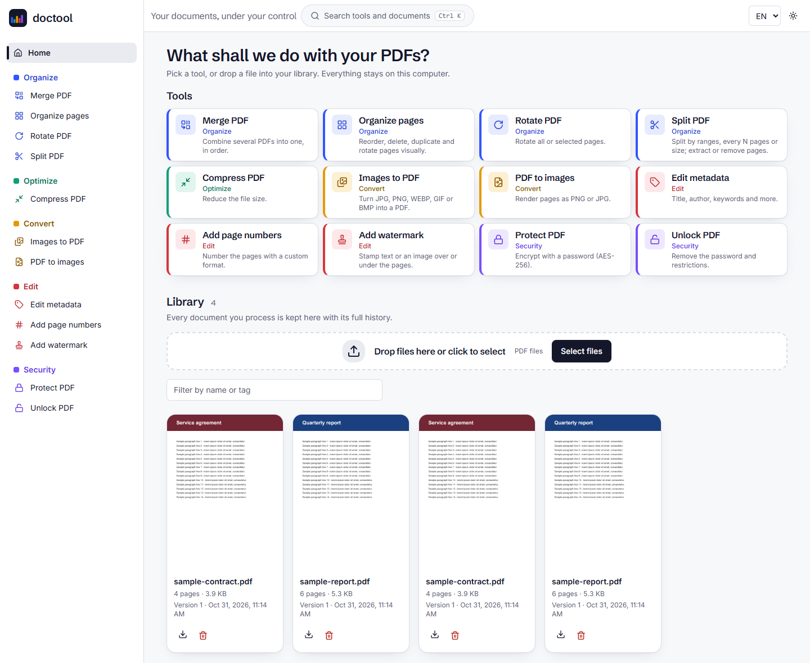
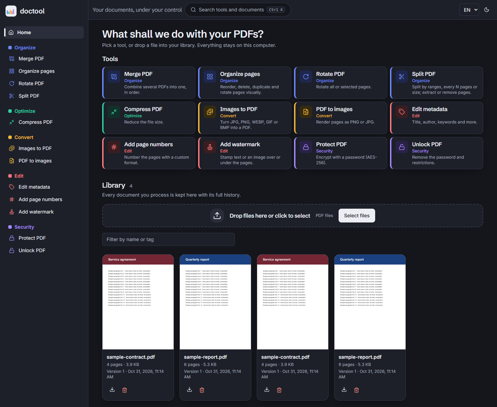
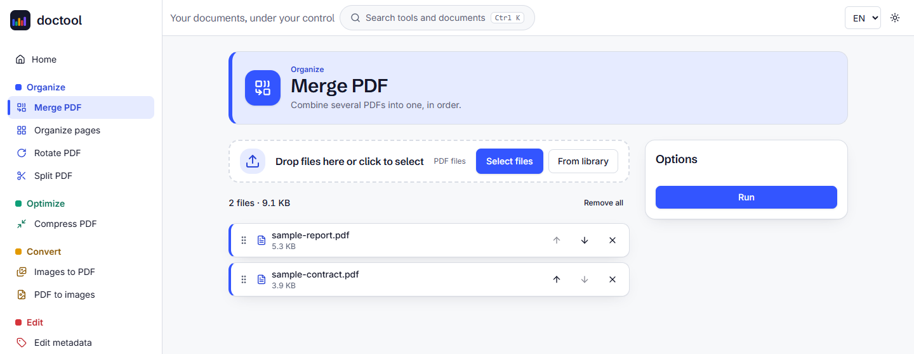
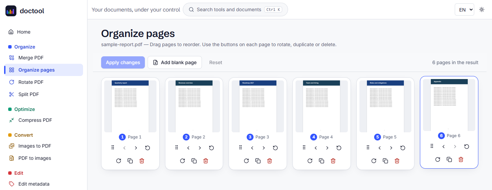

# doctool

A personal, open-source PDF toolbox that runs on your own machine. Think iLovePDF, but your files
never leave your computer, there are no limits, and every result is **remembered**: each document
keeps a version history you can browse, download and build on.

Status: **MVP v0.1 (PDF only)**. Specification: [`docs/SPEC.md`](docs/SPEC.md) ·
research: [`docs/RESEARCH.md`](docs/RESEARCH.md) · feature summary: [`docs/SUMMARY.md`](docs/SUMMARY.md).

<p align="center">
  
  
</p>

## What it does today

| Group | Tools |
|---|---|
| Organize | Merge, Split (ranges, every N pages, by size, extract, remove), Rotate, **visual page organizer** (drag to reorder, rotate, duplicate, delete, blank pages) |
| Optimize | Compress (3 levels) |
| Convert | Images → PDF, PDF → images (PNG/JPG) |
| Edit | Watermark (text or image), page numbers, metadata editor |
| Security | Protect (AES-256), Unlock |
| Images | Convert (JPG/PNG/WebP, AVIF when your Pillow supports it), Compress (web / email / maximum, never returns a bigger file), Resize, Crop (aspect ratio or pixel box), Remove photo info (EXIF/GPS). Pillow only, still pictures only, metadata removed by default |
| Office | Word, Excel, PowerPoint and HTML → PDF; PDF → Word, Excel, PowerPoint (see below) |
| Library | Every output is a new *version* of its document; history, preview, tags, rename |
| UX | Ctrl+K command palette, English/Spanish, light/dark, keyboard accessible (axe-checked) |

### Office tools

Seven tools in the **Office** group: Word to PDF (DOCX/DOC/ODT/RTF/TXT), Excel to PDF
(XLSX/XLS/ODS/CSV, sheet selection and fit to page), PowerPoint to PDF (slides or handouts,
notes, hidden slides), HTML to PDF (a saved page; nothing is fetched), and PDF to Word, PDF to
Excel (real tables) and PDF to PowerPoint (one slide per page).

The "to PDF" tools, and PDF to Word's "Keep the look" mode, need **LibreOffice** installed; without
it they show "Needs LibreOffice" and stay off. doctool starts LibreOffice as a separate program,
one conversion at a time, with macros and linked-content fetching locked off. Text recognition
(OCR) is not included yet.

* Install and troubleshoot: [`docs/office-setup.md`](docs/office-setup.md)
* Options, messages, architecture and security model: [`docs/office-module.md`](docs/office-module.md)
* Docker and exposing it safely: [`docs/deployment.md`](docs/deployment.md)

### Screenshots

| Merge: every tool page is generated from the tool's schema | Visual page organizer |
|---|---|
|  |  |

## Run it (Windows, PowerShell)

Requirements: Python 3.12+, Node 22+.

```powershell
# 1. backend dependencies (once)
python -m venv .venv
.\.venv\Scripts\python -m pip install -e "api[dev]"

# 2. build the web UI (once, and after UI changes)
cd web; npm ci; npm run build; cd ..

# 3. start (http://127.0.0.1:8000)
cd api; ..\.venv\Scripts\python -m doctool
```

Data lives in `api/data/` (SQLite + content-addressed blobs) unless `DOCTOOL_DATA_DIR` says otherwise.

### Settings (environment variables)

| Variable | Default | Meaning |
|---|---|---|
| `DOCTOOL_DATA_DIR` | `data` | where the database and files are stored |
| `DOCTOOL_PORT` | `8000` | port |
| `DOCTOOL_HOST` | `127.0.0.1` | bind address. Anything else needs `DOCTOOL_ALLOW_LAN=1` |
| `DOCTOOL_ALLOWED_HOSTS` | `127.0.0.1,localhost` | accepted `Host` headers (anti DNS-rebinding) |
| `DOCTOOL_WEB_DIR` | `web/dist` if present | built UI to serve |
| `DOCTOOL_IMAGE_MAX_PIXELS` | `50000000` | largest single picture the image tools accept (about 50 MP) |
| `DOCTOOL_IMAGE_TASK_MAX_PIXELS` | `100000000` | total pixels of one image task |
| `DOCTOOL_IMAGE_MAX_FILES` | `10` | pictures per image task |
| `DOCTOOL_IMAGE_CONCURRENCY` | `2` | image jobs running at once; others get a retryable 503 "busy" |
| `DOCTOOL_IMAGE_SLOT_WAIT_SECONDS` | `0.5` | how long a request waits for a free image slot |

## Develop

```powershell
# API with reload + UI dev server (proxy to :8000)
cd api; ..\.venv\Scripts\python -m uvicorn doctool.main:app_factory --factory --reload
cd web; npm run dev            # http://127.0.0.1:5173
```

### Checks (all must pass)

```powershell
cd api; ..\.venv\Scripts\python -m ruff check .; ..\.venv\Scripts\python -m pytest -q
cd web; npx tsc -b --noEmit; npx vitest run; npx playwright test   # e2e uses the installed Edge
```

## How it is built

* **API**: FastAPI. Every tool is one class (`doctool/tools/*.py`): an id, a Pydantic `Params`
  model and `run()`. The registry exposes it as `POST /api/v1/tasks` (the same
  start → upload → process → download contract iLovePDF's API uses) and publishes its JSON Schema
  at `GET /api/v1/tools`.
* **UI**: React + TypeScript + Tailwind. Tool pages are **generated from that schema**, so adding a
  tool needs no UI code unless it wants a custom screen (like the organizer).
* **Engines**: pikepdf/qpdf (structure), pypdfium2 (rendering), reportlab (stamps), img2pdf, Pillow.
  PyMuPDF is deliberately not used (AGPL).
* **Storage**: SQLite + blobs addressed by SHA-256 (identical files are stored once).
* Add a tool: copy `doctool/tools/rotate.py`, register it in `tools/__init__.py`, write its test.

## Security model

doctool is a single-user local app with **no login**, so exposure is what protects it:

* binds to `127.0.0.1` only (LAN needs an explicit opt-in);
* rejects foreign `Host` headers and cross-origin writes (DNS-rebinding / CSRF);
* strict CSP on the UI, `nosniff` everywhere, filenames sanitised and never used as paths;
* passwords are never written to disk (held in memory until the task runs; history shows `***`);
* uploaded PDFs are parsed, never executed (no JavaScript engine involved).

## Known limits (honest list)

* **Image tools** read JPEG, PNG, WebP, AVIF, GIF, BMP and TIFF (other formats Pillow knows, such as EPS, are refused on purpose). Animated pictures are rejected. Processing is synchronous and in memory, so the caps above matter on a public server. Video and GIF to WebM are not part of this version.
* **Compression** recompresses images with Pillow; Ghostscript (stronger) is not integrated yet.
* **Tools output unprotected files**: if you give a password to a tool, the result is not encrypted
  again; use *Protect* as the last step.
* Watermark / page-number text supports Latin characters (built-in PDF fonts).
* There is no page-count cap yet (only a 200 MB upload cap): a huge PDF can use a lot of memory.
* The Docker files and CI workflow are written but **have not been run** (no Docker/GitHub on the
  development machine).
* OCR (text recognition for scanned PDFs) is not shipped yet. PDF → Word/Excel/PowerPoint and Office → PDF exist; see [`docs/office-module.md`](docs/office-module.md) for their limits.

## License

Apache-2.0, see [`LICENSE`](LICENSE).
