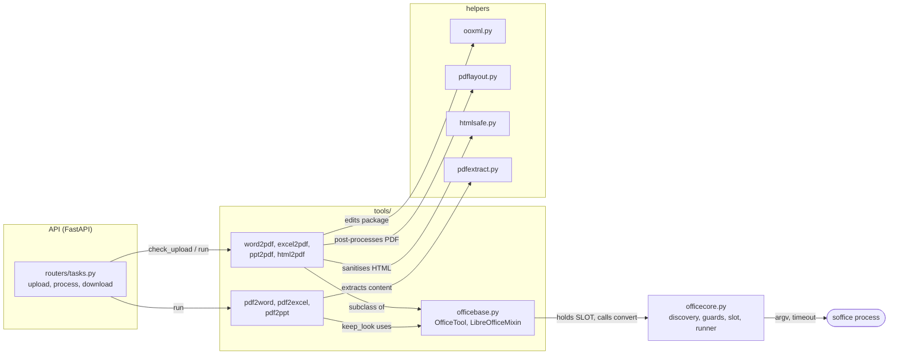
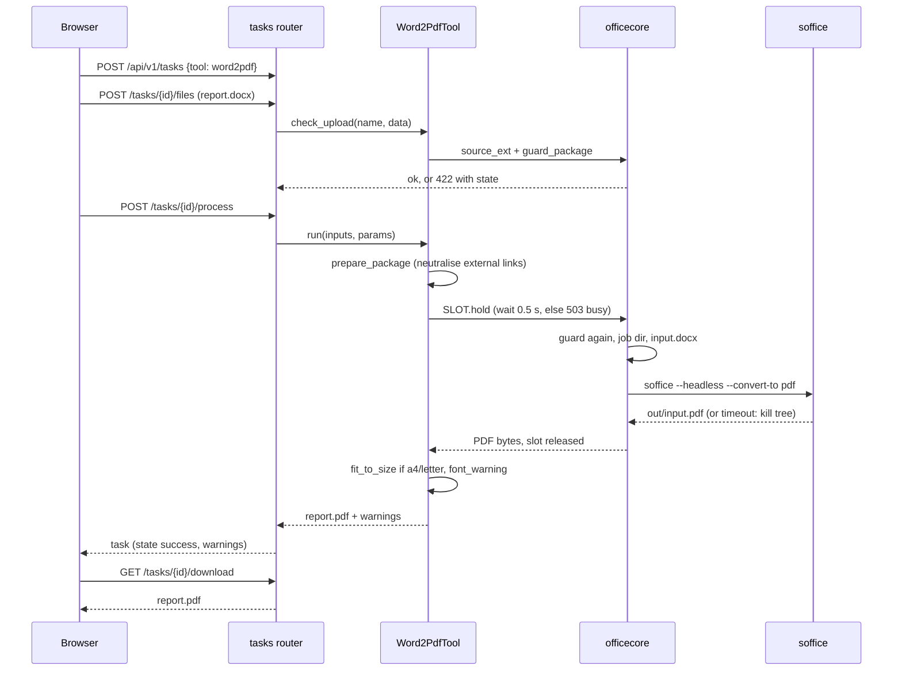
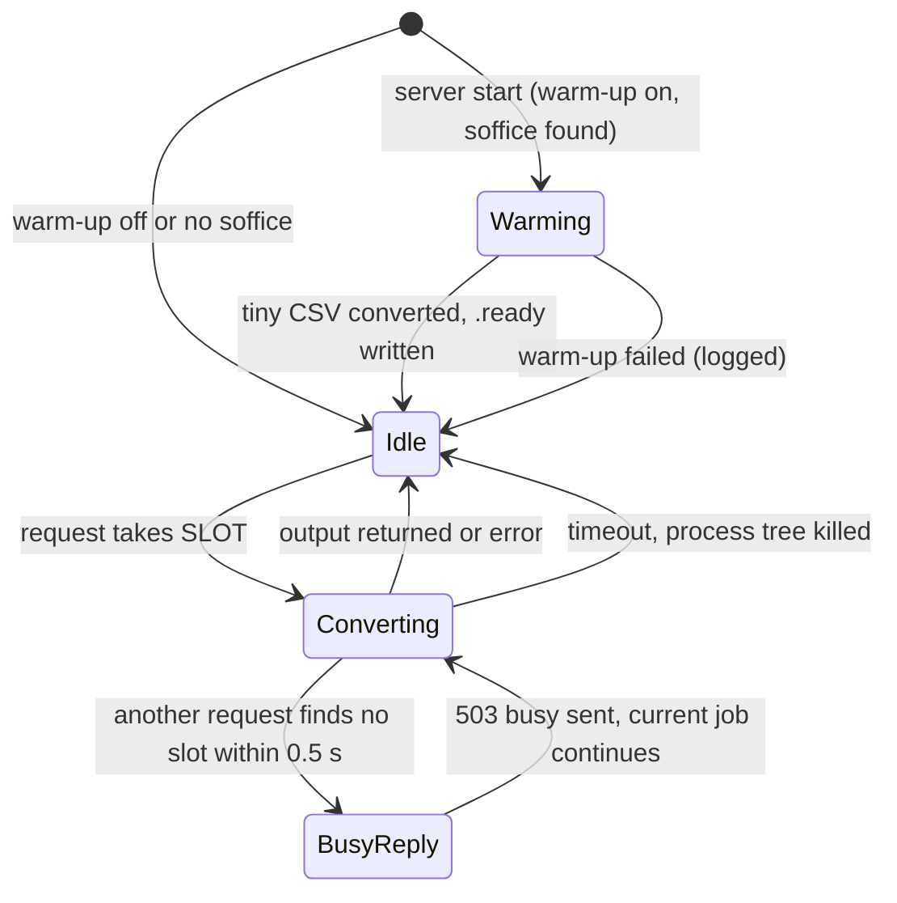

# Office module

How doctool's seven Office tools work, what each one accepts and returns, how they defend against
hostile documents, and how to add a new one.

**Who this is for:** users who want the exact options and messages (the
[reference](#reference) part), and contributors who will change or extend the module (the
[explanation](#how-it-works) part and the [how-to](#how-to-add-a-new-office-tool)).

To install LibreOffice first, follow [office-setup.md](office-setup.md).

## Reference

### Tools at a glance

| Tool id | Title | Input | Output | Engine |
|---|---|---|---|---|
| `word2pdf` | Word to PDF | `.docx` `.doc` `.odt` `.rtf` `.txt` | `<name>.pdf` | LibreOffice |
| `excel2pdf` | Excel to PDF | `.xlsx` `.xls` `.ods` `.csv` | `<name>.pdf` | LibreOffice |
| `ppt2pdf` | PowerPoint to PDF | `.pptx` `.ppt` `.odp` | `<name>.pdf` | LibreOffice |
| `html2pdf` | HTML to PDF | `.html` `.htm` | `<name>.pdf` | LibreOffice |
| `pdf2word` | PDF to Word | PDF | `<name>.docx` | own extractor; LibreOffice for "Keep the look" |
| `pdf2excel` | PDF to Excel | PDF | `<name>.xlsx` | own extractor |
| `pdf2ppt` | PDF to PowerPoint | PDF | `<name>.pptx` | PDFium rendering |

- Every tool takes exactly one file. `<name>` is the input file name without its extension.
- PDF results can be saved to the library as a new version. DOCX/XLSX/PPTX results are download
  only.
- Macro-enabled files (`.docm` `.xlsm` `.pptm` `.dotm` `.xltm` `.potm` `.ppsm` `.xlam`) are
  never accepted.
- PDF inputs can be encrypted: give the password in the task and doctool decrypts a copy first.
- The tool list, with the JSON Schema of every parameter and `available`/`requires`/`extensions`,
  is served at `GET /api/v1/tools`.

### Parameters

The tables below come from the Pydantic `Params` models in `api/doctool/tools/<id>.py`.

#### word2pdf

| Name | Type | Default | Description |
|---|---|---|---|
| `page_size` | `original` \| `a4` \| `letter` | `original` | Keeps the size set in the document. `a4`/`letter` scale every page to fit, keeping each page's orientation |

#### excel2pdf

| Name | Type | Default | Description |
|---|---|---|---|
| `sheets` | string, max 500 chars | `""` (all) | Sheet names or numbers separated by commas, for example `1,3` or `Summary`. Names match without case. Numbers count visible tabs only (1 = first visible sheet; hidden sheets take no number). Hidden sheets are never printed |
| `orientation` | `auto` \| `portrait` \| `landscape` | `auto` | `auto` picks landscape when a sheet uses more than 10 columns |
| `fit_width` | boolean | `true` | Shrinks wide sheets so no column moves to another page |
| `fit_sheet` | boolean | `false` | Each sheet becomes a single page. Large sheets get very small text |

Inputs other than `.xlsx` are first converted to XLSX by LibreOffice, so the print settings are
applied the same way to every format. CSV delimiter (`,` `;` tab `|`) is detected; CSV is read as
UTF-8. CSV formulas are not evaluated: a cell such as `=1+41` stays text (test
`test_csv_formulas_are_not_evaluated`).

#### ppt2pdf

| Name | Type | Default | Description |
|---|---|---|---|
| `handout` | `slides` \| `h2` \| `h3` \| `h4` \| `h6` \| `h9` | `slides` | `slides` is one slide per page. `hN` places N framed slides on each portrait A4 page |
| `include_notes` | boolean | `false` | Adds each slide's speaker notes under it. Only applies when `handout` is `slides` |
| `include_hidden` | boolean | `false` | Hidden slides are skipped unless this is on |

#### html2pdf

| Name | Type | Default | Description |
|---|---|---|---|
| `page_size` | `a4` \| `letter` | `a4` | Paper size, with 15 mm margins |
| `orientation` | `auto` \| `portrait` \| `landscape` | `auto` | `landscape` turns the page and wins over the document's own `@page` rule. With `auto`, doctool's rule is added first, so a page that sets its own `@page` size keeps it; otherwise the result is portrait |
| `print_backgrounds` | boolean | `true` | Turn off to drop background colours and images |

There is no URL field on purpose: the tool never fetches anything.

#### pdf2word

| Name | Type | Default | Description |
|---|---|---|---|
| `fidelity` | `editable` \| `keep_look` | `editable` | `editable` rebuilds headings, paragraphs, real tables and pictures as flowing Word content. `keep_look` uses LibreOffice's PDF import: closer to the page, harder to edit, needs LibreOffice |
| `include_images` | boolean | `true` | Pictures at least 24 pt wide and high are cut from the page and placed in the document (`editable` only). On a page too large to render, its pictures are skipped and counted in an `images_skipped` warning |

`keep_look` is offered only when LibreOffice is installed: without it, `GET /api/v1/tools` lists
only `editable` for `fidelity`.

#### pdf2excel

| Name | Type | Default | Description |
|---|---|---|---|
| `table_layout` | `per_sheet` \| `one_sheet` | `per_sheet` | `per_sheet` puts each table on a sheet named `P<page> T<n>`. `one_sheet` stacks all tables on a sheet named `Tables`, each under a "Page X, table N" heading |
| `pages` | string, max 200 chars | `""` (all) | Pages to search for tables, for example `1-3, 5` |

Whole numbers and decimals become numbers. Everything else is stored as text, so a cell such as
`=1+1` from a PDF is never a formula.

#### pdf2ppt

| Name | Type | Default | Description |
|---|---|---|---|
| `slide_content` | `picture` \| `picture_text` | `picture` | `picture` makes each slide an image of the page. `picture_text` also puts the page text behind the image so it can be searched and copied |
| `dpi` | integer, 72 to 300 | `150` | Rendering resolution. Higher is sharper and bigger |

Slides take the proportions of the first page, within PowerPoint's limits of 1 to 56 inches. All pages together may render at most
`DOCTOOL_OFFICE_RENDER_BUDGET_PIXELS` pixels (default 1,500,000,000); above that the task fails
with `too_large`.

pdf2word, pdf2excel and pdf2ppt run in the bounded task lanes (`_SLOTTED_TOOL_IDS` in
`api/doctool/routers/tasks.py`), like the image tools, so heavy PDF jobs cannot pile up.

### Warning codes

A warning means the task succeeded but you should check the result. Warnings are returned in
`Task.warnings` as `{"code", "params"?, "action"?}`; the UI shows the text from
`web/src/i18n/en.ts` (`warnings.*`).

| Code | Params | Emitted by | When |
|---|---|---|---|
| `font_substituted` | `fonts` (up to 5 names) | word2pdf, excel2pdf, ppt2pdf | A DOCX/XLSX/PPTX asks for fonts that do not appear in the PDF. Excel inputs are checked after the XLSX normalisation |
| `macros_removed` | none | word2pdf, excel2pdf, ppt2pdf | A legacy `.doc`/`.xls`/`.ppt` holds a VBA project. Macros were never run |
| `external_links_blocked` | `count` | word2pdf, excel2pdf, ppt2pdf (DOCX/XLSX/PPTX), html2pdf | External references were neutralised before conversion (see [security](#security-model)) |
| `hidden_skipped` | `count` | excel2pdf, ppt2pdf (PPTX only, when `include_hidden` is off) | Hidden sheets or slides were left out |
| `no_text_layer` | `pages` (for example `1-3, 5`) | pdf2word (`editable`) | Some pages have no text (scanned) and were kept as pictures. An `action: {"tool": "ocr"}` is added only when an `ocr` tool is registered, which is not the case today |
| `images_skipped` | `count` | pdf2word (`editable`) | Pictures were found but not carried over because their page is too large to render |

### Error states

Errors carry a `state`. Upload checks answer `422` (`413` for a file over 200 MB); failures while
processing answer `400` with `{"type": "ProcessingError", "state", "message"}`; `busy` answers
`503` and is retryable.

| State | Raised when |
|---|---|
| `engine_missing` | LibreOffice is not found when a conversion starts (also `pdf2word` with `keep_look`) |
| `busy` | The LibreOffice lane is taken for longer than `DOCTOOL_OFFICE_SLOT_WAIT_SECONDS` (`503`, retryable) |
| `timeout` | A conversion ran longer than `DOCTOOL_OFFICE_TIMEOUT_SECONDS`; the process tree was killed |
| `macro` | Macro-enabled extension, or a package that holds `vbaProject.bin`, root `Basic/`, `Scripts/` or `Macros/` folders, `/basic/` parts or a macro-enabled content type |
| `unsafe` | A package entry with an absolute or `..` path, or an XML part with entity declarations or an inline DTD |
| `unsupported` | The extension is not an allowed office type, or not one this tool accepts; or a `.txt`/`.csv`/`.html`/`.htm` file whose content is really a package, a legacy binary or RTF |
| `damaged` | Not a valid package or legacy Office file, LibreOffice failed or produced no single non-empty output, an XLSX has no workbook part, or a damaged PDF; an `.rtf` that does not start with `{\rtf`; a legacy file without the OLE signature |
| `wrong_password` | An encrypted Office package (not supported: remove the password first), or a PDF whose password is missing or wrong (retryable) |
| `out_of_range` | excel2pdf: none of the selected sheets exists or is visible. pdf2excel: an invalid `pages` range |
| `too_large` | A package with more than `DOCTOOL_OFFICE_MAX_ENTRIES` parts or that expands past the size/ratio limits (the ratio is also checked per part); a LibreOffice result over `DOCTOOL_OFFICE_MAX_OUTPUT_BYTES`; a PDF over `DOCTOOL_OFFICE_MAX_PDF_PAGES` (pdf2excel counts the selected pages); pages that together exceed `DOCTOOL_OFFICE_RENDER_BUDGET_PIXELS` at the chosen dpi (pdf2ppt); an upload over 200 MB |
| `no_text` | pdf2word `editable`: no page has text (the PDF looks scanned) |
| `no_tables` | pdf2excel: no table was found on the selected pages |

## How it works

### Components



The router calls a tool; LibreOffice tools go through `officebase` to `officecore`, which is the
only code that starts `soffice`. The helpers never start a process: they edit OOXML, reshape PDFs,
clean HTML or read PDF content.

| Module | Role |
|---|---|
| `api/doctool/officecore.py` | Finds `soffice`; extension allowlist; package guards; macro-locked profile; process runner with tree kill; the single `SLOT`; `convert()`; warm-up and the longer first timeout |
| `api/doctool/tools/officebase.py` | `LibreOfficeMixin.lo_session()` holds the lane for a whole task and yields `convert`; `OfficeTool` adds `accepts = "office"`, `requires = ("libreoffice",)`, `extensions` and `check_upload`; shared steps `prepare_package`, `font_warning`, `pdf_filter`, `output_name` |
| `api/doctool/ooxml.py` | Surgical OOXML edits: neutralise external relationships, XLSX page setup and sheet selection, fonts used, hidden slides, legacy macro detection |
| `api/doctool/pdflayout.py` | Fit pages to A4/Letter, n-up handouts, fonts in a PDF and substitution check |
| `api/doctool/htmlsafe.py` | Remove scripts, active content and external references from HTML; set `@page` size in mm |
| `api/doctool/pdfextract.py` | Headings, paragraphs, tables and pictures from PDF pages (pdfplumber + PDFium); page rendering for slides |
| `api/doctool/engines.py` | `engine_available("libreoffice")`, checked per call so `GET /api/v1/tools` reports `available` |

### One Word to PDF request



The upload is checked once at upload time and again inside `convert()`. The slot is held only
around the LibreOffice step; font checks and page fitting run after it is released.

### The LibreOffice lane



There is one lane per server process. While it is warming, a request waits up to 180 s for it
instead of getting `busy`; while it is converting, a second request waits
`DOCTOOL_OFFICE_SLOT_WAIT_SECONDS` and then gets a retryable `503`.

### Why one conversion at a time

LibreOffice profiles do not tolerate concurrent use, and a cold profile costs about 20 s to build.
doctool keeps one persistent, macro-locked profile in `<data dir>/office/profile` and serialises
every conversion through a process-wide lock (`officecore.SLOT`). The lock lives in memory, so
run doctool as a single server process (the default `python -m doctool` does).

A task that needs two LibreOffice steps (excel2pdf: normalise to XLSX, then print) holds the lane
for both, so another request cannot slip in between.

### Why PDF to Word does not use LibreOffice by default

A spike on five real PDFs (`docs/RESEARCH.md`, S2) found that LibreOffice's PDF import keeps the
text but produces no real Word tables and puts text in 75 to 442 positioned frames per file. The
own extractor (`pdfextract.py`, pdfplumber) produced flowing paragraphs and real tables. So
`editable` is the default and `keep_look` is the LibreOffice option. AGPL engines (pdf2docx,
PyMuPDF) are excluded because doctool is Apache-2.0.

## Security model

Every uploaded document is treated as hostile.

| Defence | Where | What it does |
|---|---|---|
| Extension allowlist | `officecore.source_ext` | Only `docx xlsx pptx odt ods odp doc xls ppt rtf txt csv html htm`; macro-enabled extensions are refused with `macro` |
| Macro lock | `officecore.prepare_profile` | The profile sets `MacroSecurityLevel` 3 and `DisableMacrosExecution` true; packages with VBA, `Basic/`, `Scripts/` or `Macros/` parts are refused before conversion |
| No linked-content fetching | `officecore._MACRO_LOCK` | The profile sets `BlockUntrustedRefererLinks` and a dead manual proxy (`127.0.0.1:9`), so LibreOffice neither loads linked images over the network nor embeds `file:///` ones. Measured for a legacy `.doc` on LibreOffice 26.8 ([O8 spike](RESEARCH.md#o8-security-spike-does-libreoffice-fetch-linked-content-2026-11-08-libreoffice-26811-windows); test `test_legacy_doc_links_are_never_fetched`) |
| No formula recalculation | `officecore._MACRO_LOCK` | `OOXMLRecalcMode` and `ODFRecalcMode` are set to never recalculate on load, so formulas such as `WEBSERVICE()` stay as saved. CSV formulas are not evaluated either |
| Profile version | `officecore.PROFILE_VERSION` | A profile written by an older doctool is re-locked on the next conversion |
| Forced import filter | `officecore.INFILTERS` | LibreOffice is told the format from the extension and does not guess it from the content |
| Flat-file sniffing | `officecore.sniff_flat` | `.rtf` must start with `{\rtf`; `.txt`, `.csv`, `.html`, `.htm` must not be a package, an OLE binary or RTF in disguise; legacy `.doc/.xls/.ppt` must carry the OLE signature |
| Zip-bomb guards | `officecore.guard_package` | At most 5000 parts, 500 MiB unpacked, ratio 200 in total and per part (all configurable); entries with absolute or `..` paths refused |
| XML entity guard | `officecore.guard_package`, `ooxml._PARSER` | The whole of each `.xml`/`.rels` part is scanned in chunks for `<!ENTITY` and `<!DOCTYPE`, in UTF-8 and UTF-16; doctool's own XML parser never resolves entities or reads the network |
| Encrypted packages | `officecore.guard_package` | Refused with `wrong_password` instead of being handed to LibreOffice |
| External relationships neutralised | `ooxml.neutralize_external` | In DOCX/XLSX/PPTX, every external target except hyperlinks (images, OLE links, templates, frames) is emptied so LibreOffice cannot load it |
| HTML sanitised | `htmlsafe.sanitize` | Drops `script`, `iframe`, `object`, `embed`, `base`, `link` and similar tags, `on*` handlers, `srcset`, URL attributes other than `data:image/` and `#`, CSS `url()`, `@import` and expressions, refresh/cookie/CSP meta tags; `javascript:`, `vbscript:` and `file:` links |
| Argv only | `officecore.convert`, `run_process` | No shell, no stdin; the input is always written as `input.<ext>`, so the upload name never reaches the command line |
| Per-job folder | `officecore.convert` | Each conversion runs in a fresh `job-*` folder under `<data dir>/office`, deleted afterwards |
| Tree kill | `officecore._kill_tree` | On timeout the whole process group is killed (`taskkill /T /F` on Windows, `SIGKILL` to the session on Linux/macOS) |
| One job at a time | `officecore.SLOT` | Limits memory and CPU to one LibreOffice at a time |
| Output check | `officecore.convert` | Exit code 0 and exactly one non-empty output of the expected type, or `damaged`; a result over `DOCTOOL_OFFICE_MAX_OUTPUT_BYTES` is `too_large` |

### Honest limits

- **Network blocking is a deployment concern.** doctool removes the references it knows about, but
  it does not stop the `soffice` process from opening network connections. The profile settings
  above are the first barrier; egress blocking stays recommended as defence in depth. Block egress
  at the container or firewall level ([deployment.md](deployment.md#3-block-outgoing-network-traffic)).
- **Legacy, ODF and RTF links are not rewritten in the file.** Only DOCX/XLSX/PPTX relationships
  are edited. `.doc`, `.xls`, `.ppt`, `.odt`, `.ods`, `.odp` and `.rtf` go to LibreOffice as they
  are; the profile is configured so LibreOffice does not fetch their linked content. This was
  measured for legacy `.doc` on LibreOffice 26.8 only ([O8 spike](RESEARCH.md#o8-security-spike-does-libreoffice-fetch-linked-content-2026-11-08-libreoffice-26811-windows)).
- **Legacy macros are accepted, not removed from the input.** A `.doc`/`.xls`/`.ppt` with VBA is
  converted with macros locked off and a `macros_removed` warning.
- **pdf2word assumes one text column.** Multi-column pages keep their text but the reading order
  may interleave. Tables without clear lines, merged cells and tables that continue on the next
  page may come out wrong.
- **The profile is shared** by all conversions of a server; it is not rebuilt per job.
- **The slot is per process.** Several server workers would share one profile without a common
  lock.

## How to add a new office tool

Use this when your tool takes an office document and needs LibreOffice. Tools that take a PDF and
only sometimes need LibreOffice follow `pdf2word.py` instead (subclass `LibreOfficeMixin` and
`Tool`).

1. **Create `api/doctool/tools/<id>.py`.** Subclass `OfficeTool`, set `id`, `title`,
   `group = "office"`, `description`, `extensions` (lower case, no dot, a subset of
   `officecore.ALLOWED_EXT`) and a Pydantic `Params` model. Give every field a default (running
   with no edits must work) and a `description` (the UI falls back to it when no hint exists);
   use string enums (`Literal[...]`) rather than numbers.

   ```python
   from typing import Literal

   from pydantic import BaseModel, Field

   from doctool.tools.base import ToolInput, ToolOutput, registry
   from doctool.tools.officebase import OfficeTool, font_warning, output_name, prepare_package


   class OdtTidyParams(BaseModel):
       page_size: Literal["original", "a4"] = Field("original", description="Paper size.")


   class OdtTidyTool(OfficeTool):
       id = "odttidy"
       title = "Tidy ODT"
       group = "office"
       description = "One sentence for the tool header."
       Params = OdtTidyParams
       extensions = ("odt",)

       def run(self, inputs: list[ToolInput], params: OdtTidyParams) -> list[ToolOutput]:
           item = inputs[0]
           ext = self.source_ext(item.name)
           data, warnings = prepare_package(item.data, ext)
           with self.lo_session() as convert:
               pdf = convert(data, ext, "pdf")
           warnings += font_warning(item.data, ext, pdf)
           return [ToolOutput(output_name(item.name, "pdf"), pdf, warnings=warnings)]


   registry.register(OdtTidyTool())
   ```

   Do all LibreOffice steps inside one `lo_session()` block. Raise `ToolError(state, message)`
   with a documented state for expected failures.

2. **Register it** by adding the module to the import list in `api/doctool/tools/__init__.py`.

3. **Add the UI copy** to both `web/src/i18n/en.ts` and `web/src/i18n/es.ts`:
   - `tools.<id>.title` and `tools.<id>.description`;
   - `tools.<id>.note` if the result is not faithful to the original (it is shown above the drop
     area);
   - `params.<name>` for new parameter labels and `values.<value>` for new enum values (both are
     shared by all tools);
   - `hints.<id>.<param>` for the help text under each option;
   - `warnings.<code>` for any new warning code.

4. **Add an icon** to `TOOL_ICONS` in `web/src/lib/toolIcons.ts` (a `lucide-react` export).
   Unknown ids fall back to a generic document icon.

5. **Use the office wording for errors** by adding the id to `OFFICE_TOOLS` in
   `web/src/lib/errors.ts`. Optionally add search keywords in
   `web/src/components/CommandPalette.tsx`.

6. **Write tests** in `api/tests/`. Tests that start the real LibreOffice must carry the `office`
   marker and skip when it is missing:

   ```python
   import pytest

   from doctool import officecore

   pytestmark = [
       pytest.mark.office,
       pytest.mark.skipif(officecore.find_soffice() is None, reason="LibreOffice not installed"),
   ]
   ```

   `api/tests/test_office_tools.py` shows how to drive a tool through the API.

### Verify it worked

```powershell
cd api; ..\.venv\Scripts\python -m ruff check .; ..\.venv\Scripts\python -m pytest -q
..\.venv\Scripts\python -m pytest -m office -q
cd ..\web; npx tsc -b --noEmit; npx vitest run
```

Then start doctool and check that the new tool appears under **Office** and in
`GET /api/v1/tools`.

## Related

- [office-setup.md](office-setup.md): install LibreOffice, settings, troubleshooting.
- [deployment.md](deployment.md): Docker and network exposure.
- [design/office-tools.md](../design/office-tools.md): UI specification of the module.
- [RESEARCH.md](RESEARCH.md): engine spikes behind these choices.
